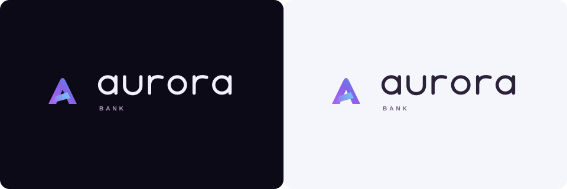

# Aurora Bank



Painel financeiro em TypeScript com contas pessoais e empresariais, histórico persistente e interface responsiva. Desenvolvido a partir do desafio **Construindo Uma App Simples de Banco Com Typescript**, da DIO.

## Funcionalidades

- Contas Essencial, Negócios e Mais, com cadastro de titulares.
- Depósito, saque, crédito empresarial e bônus de R$10 na conta Mais.
- Saldo e movimentações persistidos em SQLite.
- Fluxo dos últimos sete dias calculado a partir do histórico.
- Busca, filtro por operação e exportação CSV/JSON.
- Bloqueio de movimentações em contas inativas.
- Temas escuro e claro, preferência salva e ocultação dos valores.
- Interface para celular, tablet e desktop, com navegação por teclado.

## Executar

**Requisito:** Node.js 24 ou superior.

```sh
git clone https://github.com/EVI-DEV1/dio-aurora-bank.git
cd dio-aurora-bank
npm ci
npm run dev
```

Acesse **http://127.0.0.1:5173**. O comando inicia o Vite e a API local. As portas 5173 e 3001 precisam estar disponíveis.

Para utilizar a versão compilada:

```sh
npm run build
npm start
```

Acesse **http://127.0.0.1:3001**. No Windows, `Iniciar-Aurora.cmd` instala as dependências, compila e inicia esse modo.

## Testes

```sh
npm test
npm run build
npm run demo
npm run check
```

Os 14 testes cobrem o domínio monetário, o armazenamento SQLite, a API HTTP, a idempotência, o cálculo semanal e a exportação segura de CSV. A demonstração em `app.ts` executa os três tipos de conta. O registro das verificações está em [VERIFICACAO.md](VERIFICACAO.md).

## Estrutura

| Local | Responsabilidade |
| --- | --- |
| `src/class/` | Classes e regras bancárias |
| `src/lib/` | Cálculo do fluxo semanal e exportação |
| `src/services/` | Comunicação com a API |
| `src/ui/` | Preferência de tema |
| `src/styles/` | Componentes e temas |
| `server/` | Rotas HTTP e persistência SQLite |
| `tests/` | Testes de domínio, armazenamento e integração |
| `public/brand/` | Símbolo, assinaturas e favicon SVG |
| `design/` | Referências vetoriais e tokens |

## Regras de negócio

O saque exige conta ativa e saldo **estritamente maior** que o valor solicitado. Empréstimos são exclusivos da conta empresarial ativa. A conta Mais credita R$10 adicionais por depósito válido. Valores são tratados em centavos inteiros; nome e número da conta são privados e imutáveis. [Matriz dos requisitos](MATRIZ-REQUISITOS.md).

## Dados e execução local

Os dados iniciais são fictícios. Não há movimentação de dinheiro real ou integração com instituições financeiras.

O arquivo `data/aurora.sqlite` é criado na primeira execução e preservado ao reiniciar. `data/`, dependências e build não acompanham o repositório. Para uma cópia física do banco, encerre o servidor e copie a pasta `data/` completa. A exportação JSON é legível, mas esta versão não possui importador automático.

O servidor é restrito à máquina local. Não há autenticação ou separação por usuário; publicação multiusuário exige essas camadas e os demais controles descritos em [ARQUITETURA.md](ARQUITETURA.md).

## Design

A identidade combina um monograma A em faixas de luz, letras geométricas vetoriais e acentos violeta/ciano. Os temas utilizam tokens semânticos. As referências do [Figma](https://www.figma.com/design/OSOyAXjVSuyMfrcq0SgNNv/Sem-t%C3%ADtulo?node-id=10-1178) são estáticas e editáveis; a aplicação é a referência dos fluxos e da responsividade.

## Atribuição

O desafio e os conceitos de origem são de Nathally Souza/DIO: [digitalinnovationone/desafio01-ts](https://github.com/digitalinnovationone/desafio01-ts). O Aurora acrescenta interface, identidade visual, persistência, API e testes aos requisitos propostos.
